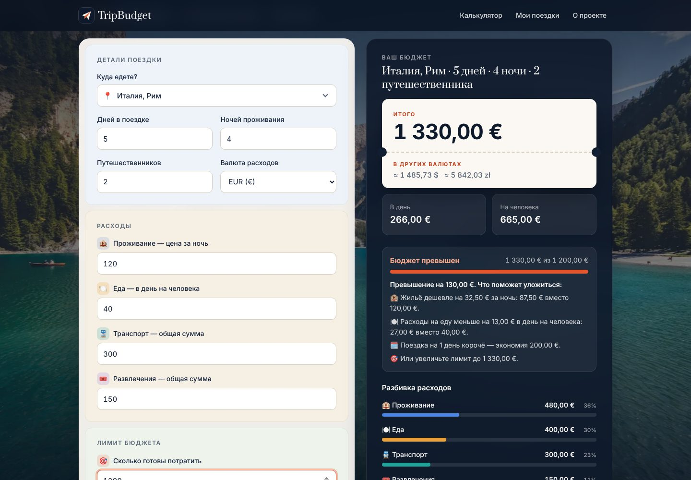
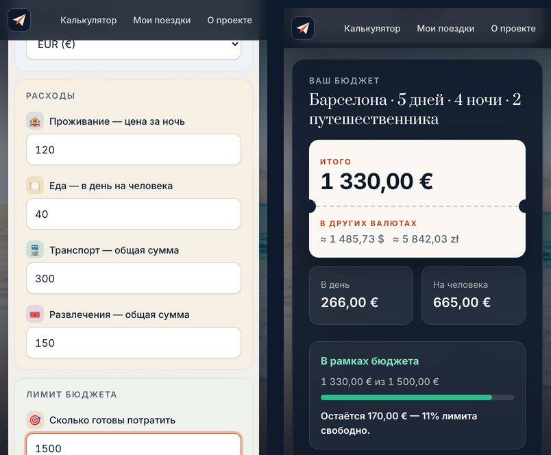
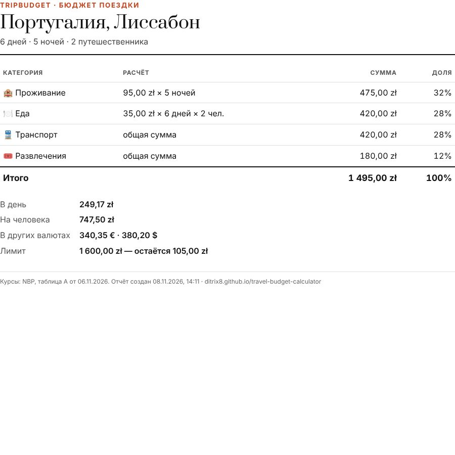
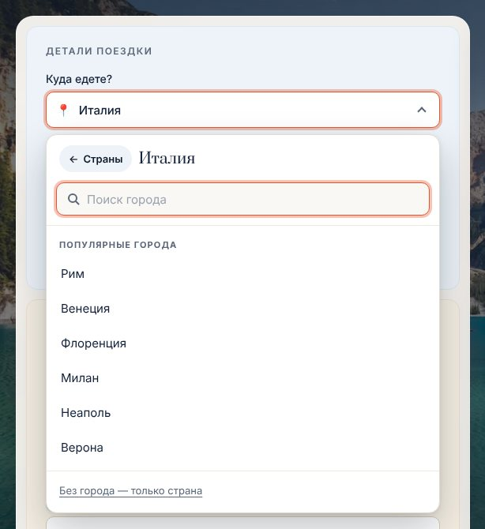
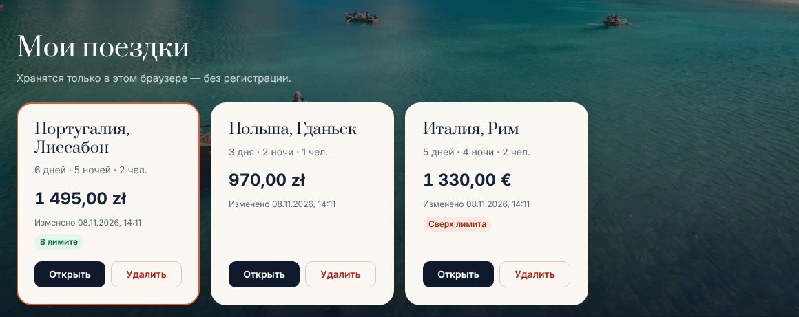

# ✈️ TripBudget — Travel Budget Calculator

**Plan what a trip will cost before you book it.** TripBudget turns accommodation, food,
transport and activities into a clear budget — total, per day and per person — with live
exchange rates from the National Bank of Poland, saved trips, a budget limit with
savings tips, and a printable PDF report.

**🔗 Live demo: https://ditrix8.github.io/travel-budget-calculator/**

> Interface language: Russian · Currencies: EUR, USD, PLN · No sign-up, no tracking.



---

## Features

| | |
|---|---|
| **Destination picker** | One field, *«Куда едете?»*, opens a two-step dropdown: **country** (search, popular destinations, then all 244 countries A–Z) → **city** (its own search over ~30,000 real cities, popular ones first, a back button). The result reads *«Италия, Рим»*. Live filtering in Russian or English, search by city ("рим" → Italy) and keyboard support. Only real cities from the list can be chosen — made-up names are rejected. |
| **Instant calculation** | Totals update as you type: total, cost per day, cost per person and a colour-coded breakdown with exact percentages (always adding up to 100%). |
| **Live exchange rates** | Average rates from the official [NBP API](https://api.nbp.pl/) (table A), refreshed on every visit and hourly. Shows 1 EUR → PLN, 1 USD → PLN, 1 USD → EUR with the rate date and last update time. |
| **Currency conversion** | The trip total is converted into the other two currencies automatically. |
| **Budget limit & tips** | Set how much you want to spend. TripBudget shows what's left — or, if you're over, concrete ways to fit (e.g. *"accommodation €32.50 cheaper per night"*, *"one day shorter saves €200"*). |
| **Saved trips** | Save, reopen, edit and delete trips (with undo). Stored only in your browser via `localStorage`. |
| **PDF report** | A clean, print-optimised budget report — use the browser's *Save as PDF*. |
| **Responsive** | Designed for phones (from 320px), tablets and desktops. |
| **Accessible** | Keyboard navigation, skip link, visible focus states, screen-reader announcements, respects *reduce motion*. 0 violations in axe-core audits. |

<p>
  
  
</p>

<p>
  
  
</p>

---

## Tech stack & decisions

Plain **HTML, CSS and JavaScript** — no frameworks, no build step, no dependencies.
The site runs as-is on any static host.

- **Pure functions for all math** (`js/core.js`). Calculations, validation, conversion and
  tips never touch the page, which makes them easy to test and reason about.
- **Money rounding to cents** (`0.1 + 0.2` would otherwise be `0.30000000000000004`) and a
  *largest-remainder* method so percentage labels always sum to exactly 100%.
- **Honest data only.** Exchange rates are never hard-coded: if NBP is unreachable, the last
  successfully loaded rates are shown with their timestamp, or a clear "no data" message.
- **Privacy & security.** Self-hosted fonts (no third-party requests), a strict
  Content-Security-Policy (`connect-src` limited to `api.nbp.pl`), user input is always rendered
  with `textContent` (no HTML injection), no API keys or secrets — the NBP API is public.
- **Performance.** Background photos as WebP in two sizes (≈125 KB desktop / ≈50 KB mobile,
  down from ≈375 KB JPEGs) and preloaded fonts. A full page load is 150–350 KB on desktop
  and about 130 KB on phones.
- **Visual identity.** Prata (display serif) + Inter, a navy/paper/coral palette and a
  boarding-pass styled total — designed to feel like a travel product, not a template.

## Project structure

```
travel-budget-calculator/
├── index.html            # markup, meta tags (SEO, Open Graph), CSP
├── css/style.css         # design tokens, layout, components, responsive & print styles
├── js/
│   ├── core.js           # pure functions: calculations, validation, tips, conversion, formatting
│   ├── places.js         # countries (ISO codes + browser's Intl.DisplayNames) and curated tourist cities
│   ├── destination.js    # «Куда едете?» two-step country → city picker (WAI-ARIA combobox/listbox)
│   ├── rates.js          # NBP exchange rates: loading, caching, rendering
│   ├── trips.js          # saved trips: list operations and localStorage
│   ├── app.js            # UI: form, results, trips, toasts, PDF report, background
│   └── tests.js          # 100 automated tests — run runTests() in the browser console
├── assets/
│   ├── img/bg/           # 12 landscape photos (WebP, 1600px and 960px)
│   ├── fonts/            # Inter and Prata (WOFF2, Latin + Cyrillic)
│   ├── icons/            # favicon (SVG), Apple touch icon, app icon
│   └── og-image.jpg      # social sharing preview
│   ├── data/cities/      # ~30,000 real cities from GeoNames, one small JSON file per country
├── scripts/build-cities.py  # rebuilds the city files from the GeoNames dump (Python, no dependencies)
├── docs/                 # README screenshots
└── site.webmanifest
```

## Countries and cities

- **Countries:** all ISO 3166-1 codes; names come from the browser's built-in `Intl.DisplayNames`
  (Russian and English), with friendlier overrides ("США") and search aliases ("Англия").
- **Popular cities:** a hand-checked list of tourist cities in `js/places.js` (`CITIES`), shown first.
- **All cities:** ~29,700 real cities from the free [GeoNames](https://www.geonames.org/) database
  (CC BY 4.0) — towns over 15,000 people plus national and regional capitals, without city districts.
  Names are in Russian where GeoNames has them (~59%), otherwise in the original language; search works
  in Russian and Latin script ("elblag" → Эльблонг). Same-named cities show their region
  ("Портленд (Орегон)"). Each country is a small JSON file in `assets/data/cities/`, downloaded only
  when that country is chosen.
- **Only real places:** a city can only be picked from these lists — free text is never accepted.
- **Updating the data:** download `cities1000.zip`, `alternateNamesV2.zip` and `admin1CodesASCII.txt`
  from <https://download.geonames.org/export/dump/> into one folder, then run
  `python3 -I scripts/build-cities.py FOLDER assets/data/cities` and bump `CITY_DATA_VERSION` in `js/places.js`.

## How the budget is calculated

```
Accommodation = price per night × nights
Food          = price per day per person × days × travellers
Transport     = total amount
Activities    = total amount

Total      = sum of the four
Per day    = Total ÷ days        ("—" if days is 0)
Per person = Total ÷ travellers  ("—" if travellers is 0)
In EUR/USD/PLN = Total converted via NBP mid rates (through PLN)
```

## Running locally

No installation needed. Serve the folder with any static server:

```bash
python3 -m http.server 8000
```

…and open <http://localhost:8000>. (Opening `index.html` directly also works, but browsers block
custom fonts for `file://` pages, so system fonts are used there.)

## Testing

- **Unit tests:** open the site, press `F12` → *Console*, run `runTests()`.
  100 tests cover calculations, rounding, validation, percentages, budget limits and tips,
  currency conversion, NBP response parsing, country/city search, saved-trip operations
  and the background picker.
- **End-to-end checks** (Playwright) were run for: calculation and conversion, limit and tips,
  saving/editing/deleting/undoing trips, persistence after reload, reset and "new calculation",
  the PDF report, keyboard navigation, NBP outage, blocked or corrupted storage, HTML injection,
  and layouts on iPhone SE, iPhone 13, iPad Mini and 320px screens.
- **Accessibility:** axe-core audits of desktop and mobile in empty, filled, error and over-budget states.

## Deployment

Hosted on **GitHub Pages** from the `gh-pages` branch. To publish changes:

```bash
git push origin main main:gh-pages
```

## Credits

- Exchange rates: [National Bank of Poland Web API](https://api.nbp.pl/) (public, no key required).
- Cities: [GeoNames](https://www.geonames.org/) under [CC BY 4.0](https://creativecommons.org/licenses/by/4.0/).
- Background photos: [Unsplash](https://unsplash.com) under the [Unsplash License](https://unsplash.com/license).
- Fonts: [Inter](https://rsms.me/inter/) and [Prata](https://fonts.google.com/specimen/Prata) (SIL Open Font License).

## Roadmap

- English interface (language switcher)
- Trip dates and per-day itinerary
- Export / import saved trips as a file, to move them between devices
- Optional cloud sync with an account

---

Made by [ditriX8](https://github.com/ditriX8) as a portfolio project.
